# TaskComp: Features & File Connection Map

This document maps all application features to their connected files, stores, and data flows.
Check this file before touching any feature to inspect only connected files and prevent unnecessary codebase scanning.
Update this file whenever features or files are added, modified, or deleted.

---

## 1. Feature Map Overview

```mermaid
graph TD
    App["App.tsx (Root Shell)"] --> Shell["MainLayout.tsx"]
    Shell --> Sidebar["Sidebar.tsx"]
    Shell --> TopNav["TopHeader.tsx"]

    Shell --> HomePage["HomePage.tsx"]
    Shell --> TodayPage["TodayPage.tsx"]
    Shell --> MyTasksPage["MyTasksPage.tsx"]
    Shell --> StatsPage["StatsPage.tsx"]
    Shell --> ProjectsPage["ProjectsPage.tsx"]
    Shell --> SettingsPage["SettingsPage.tsx"]

    StatsPage --> StatsMetrics["StatsMetricsRow.tsx (28 Done, 36 Created, 12h 30m, 5d)"]
    StatsPage --> TaskProgressChart["TaskProgressChartCard.tsx (Mon-Sun Bar Chart)"]
    StatsPage --> TaskDistribution["TaskDistributionCard.tsx (Donut Chart & Legend)"]
    StatsPage --> FocusTimeChart["FocusTimeChartCard.tsx (Mini Bar & Delta)"]
    StatsPage --> ConsistencyCard["ConsistencyCard.tsx (7-Day Check Grid & Streak)"]

    ProjectsPage --> ProjectsFilter["ProjectsFilterBar.tsx (Filter Tabs & + New Project)"]
    ProjectsPage --> ProjectsMetrics["ProjectsMetricsRow.tsx (5 Total, 3 Active, 1 Done, 1 Archived)"]
    ProjectsPage --> ProjectsGrid["ProjectsGrid.tsx (Study, Project, Design, Learning, Personal, Create Card)"]

    SettingsPage --> SettingsSidebar["SettingsSidebar.tsx (General, Notifications, etc.)"]
    SettingsPage --> GeneralSettings["GeneralSettingsCard.tsx (Preferences & Mascot Illustration)"]
```

---

## 2. Feature-to-File Matrix & Verification Status

| Feature | Primary Components | Stores & Services | Utilities & Assets | Max LOC Limit | Status |
|---|---|---|---|---|---|
| **Root Shell & Router** | `src/App.tsx` | `src/stores/uiStore.ts` | Routing & Modals | < 100 LOC | Active |
| **Sidebar Navigation** | `src/components/layout/Sidebar.tsx` | `src/stores/uiStore.ts` | `sleeping-cat.png` | < 150 LOC | Active |
| **Top Header** | `src/components/layout/TopHeader.tsx` | `src/stores/uiStore.ts` | `src/lib/date.ts` | < 120 LOC | Active |
| **Home Page** | `src/components/home/HomePage.tsx` | `src/db/db.ts` | `cheerful-boy.png` | < 100 LOC | Active |
| **Today Page** | `src/components/today/TodayPage.tsx` | `src/db/db.ts` | Subcomponents | < 80 LOC | Active |
| **My Tasks Page** | `src/components/mytasks/MyTasksPage.tsx` | `src/db/db.ts` | Filter & Subcomponents | < 80 LOC | Active |
| **Stats Page** | `src/components/stats/StatsPage.tsx` | `src/db/db.ts` | Charts & Metrics | < 80 LOC | Building |
| **Stats Metric Row** | `src/components/stats/StatsMetricsRow.tsx` | `src/db/db.ts` | 4 Cards with deltas | < 120 LOC | Building |
| **Task Progress Chart** | `src/components/stats/TaskProgressChartCard.tsx` | `src/lib/statsData.ts` | SVG Bar Chart | < 180 LOC | Building |
| **Task Distribution Chart**| `src/components/stats/TaskDistributionCard.tsx` | `src/lib/statsData.ts` | Donut SVG & Legend | < 140 LOC | Building |
| **Focus Time & Consistency**| `src/components/stats/FocusTimeCard.tsx`, `src/components/stats/ConsistencyCard.tsx`| `src/db/db.ts` | Grid & Mini Chart | < 120 LOC each | Building |
| **Projects Page** | `src/components/projects/ProjectsPage.tsx` | `src/db/db.ts` | Subcomponents | < 80 LOC | Building |
| **Projects Header & Stats**| `src/components/projects/ProjectsFilterBar.tsx`, `ProjectsMetricsRow.tsx` | `src/stores/uiStore.ts` | Cards & Filters | < 100 LOC each | Building |
| **Projects Grid** | `src/components/projects/ProjectsGrid.tsx` | `src/db/db.ts` | 6 Cards | < 250 LOC | Building |
| **Settings Page** | `src/components/settings/SettingsPage.tsx` | `src/stores/uiStore.ts` | Sub-navigation | < 80 LOC | Building |
| **General Settings Card** | `src/components/settings/GeneralSettingsCard.tsx` | `src/db/db.ts` | `cheerful-boy.png` & Toggles | < 250 LOC | Building |

---

## 3. Strict Verification Criteria
- **File Size Ceiling**: Strictly < 500 LOC per file.
- **Visual Accuracy**: Exact match to provided images (`media_1793948837284_3510e4af.jpg`, `media_1793948840348_ed6c5a6b.jpg`, `media_1793948856279_91684646.jpg`).
- **Illustration Assets Reused**: Cheerful Boy on Settings Card, Sleeping Cat on Sidebar.
